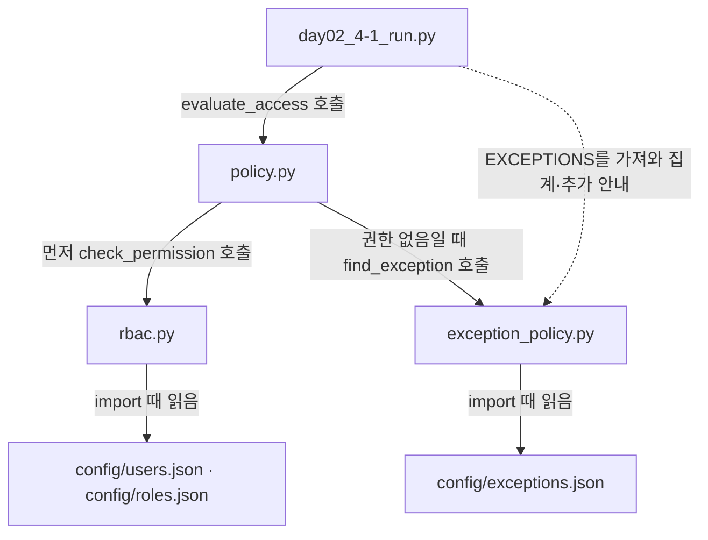

# 3과목 Day 2 역할 부여와 회수 · 예외 권한 · 정책 · 오전 (최민기 · 2026-10-22(목))

> **쓰는 법**
> - 문제를 하나 풀 때마다 그 문제 제목 아래를 채웁니다.
> - 질문마다 `쓸 내용:` 에 **무엇을 쓰면 되는지** 적혀 있습니다. 그 내용대로 `답:` 뒤에 씁니다. 코드나 출력을 붙여 넣는 질문은 `답:` 아래의 빈 코드 상자 안에 붙여 넣고, 설명은 `답:` 뒤에 씁니다.
> - 「왜 그럴까요?」 같은 질문은 한 단어로 끝내지 말고, 내 화면에서 본 값이나 배운 내용을 근거로 이유까지 씁니다.
> - 🔍 는 그 교시에 꼭 알아야 할 핵심 질문이고 이유까지 설명해야 합니다. 답을 못 찾았으면 「모름 — 막힌 곳: …」 이라고 씁니다.

---

## 2교시 · 역할 부여와 회수

### 문제 2-1 · 입사 · 이동 · 퇴사를 함수로 처리하고, 인사 변경 전과 후의 판정 비교하기

- (가) 실행한 출력 전체를 붙여 넣고, `hana` 가 사용자 딕셔너리에 들어갔는지 적어 주세요.
  - 쓸 내용: ① 출력 전체 ② `hana` 가 들어갔는지(`hana 가 사용자에 들어갔나` 줄의 값)
  - 답:

처음에는 `role_admin.py`의 함수를 채우지 않은 상태로 실행해서, 부여·회수 결과 다섯 줄이 `None`으로 나왔고 인사 변경 전후의 판정도 같았다. AI에게 출력과 코드에 대한 설명을 받고, 함수가 사용자 정보를 바꾸고 처리 결과를 반환하도록 코드를 수정했다. 다시 실행했을 때 아래 결과를 직접 확인했다.

```text
--- 인사 변경 전
minsu SALES QUERY -> False 등록되지 않은 사용자
seoyeon SALES CHANGE -> True 허용
seoyeon SETTLE QUERY -> False 권한 없음
junho SETTLE QUERY -> True 허용
--- 인사팀 통보 처리
입사 minsu (True, '부여')
입사 hana (False, '없는 역할')
hana 가 사용자에 들어갔나 False
이동 seoyeon (True, '부여')
퇴사 junho (True, '회수')
퇴사 ghost (False, '없는 사용자')
--- 인사 변경 후
minsu SALES QUERY -> True 허용
seoyeon SALES CHANGE -> False 권한 없음
seoyeon SETTLE QUERY -> True 허용
junho SETTLE QUERY -> False 퇴사한 계정
```

`hana 가 사용자에 들어갔나`는 `False`였다. `hana`에게 부여하려고 한 역할은 `sales`가 아니라 오타가 있는 `salse`였다. `assign_role`이 역할 목록에 없는 이름을 먼저 검사해 `(False, '없는 역할')`을 반환하므로, 사용자 딕셔너리에 `hana`를 추가하지 않았다.

처음 실행에서도 `hana`는 없었지만, 당시에는 함수가 사용자 정보를 바꾸는 일을 하지 않아서 없었던 것이다. 수정 후에는 잘못된 역할을 검사해서 등록을 막았다는 차이가 있다.

`minsu`는 영업 역할로 추가된 뒤 조회가 허용됐고, 없는 사용자 `ghost`의 회수 시도는 `(False, '없는 사용자')`로 나왔다. `퇴사 junho (True, '회수')`의 `True`는 회수 처리 성공이고, 뒤의 `False 퇴사한 계정`은 접근 거부다. 같은 참·거짓이라도 무엇의 결과인지 구분해서 읽어야 했다.

실행이 성공한 뒤에도 원리가 잘 이해되지 않아 AI에게 더 쉬운 설명과 답의 이유를 다시 요청했다. 특히 사용자 정보를 바꾸는 함수와 그 정보를 보고 접근을 판단하는 함수가 서로 다른 일을 한다는 점을 다시 설명받았다.

- (나) 🔍 `seoyeon` 은 영업에서 재무로 옮겼습니다. 역할 값 하나를 바꿨을 뿐인데 `SALES CHANGE` 와 `SETTLE QUERY` 의 결과가 각각 어떻게 달라졌나요? 이동한 사람에게 이전 역할의 권한이 남아 있으면 어떤 문제가 생기는지도 적어 주세요.
  - 쓸 내용: ① 두 요청의 인사 변경 전 → 후 결과 ② 이전 역할의 권한이 남아 있을 때 생기는 문제
  - 답:

같은 요청을 인사 변경 전후로 비교했을 때 다음처럼 달라졌다.

| 요청 | 변경 전: `sales` | 변경 후: `finance` |
|---|---|---|
| `seoyeon SALES CHANGE` | `True 허용` | `False 권한 없음` |
| `seoyeon SETTLE QUERY` | `False 권한 없음` | `True 허용` |

`finance` 역할에는 `SALES:QUERY`와 `SETTLE:QUERY`가 있고, `SALES:CHANGE`는 없다. `seoyeon`의 역할 칸을 `sales`에서 `finance`로 바꾸자, 판정할 때 참고하는 권한 목록도 재무 역할의 목록으로 바뀐 것이다.

실행이 성공한 뒤에도 이해가 잘되지 않아 설명을 다시 요청했고, 역할 값 하나와 여러 권한의 판정이 어떻게 연결되는지 설명받았다. 이번 구조는 사용자마다 권한을 하나씩 저장하는 대신, 사용자의 역할을 찾고 그 역할에 연결된 권한 목록을 확인한다. 따라서 역할 값의 변경이 판정에 함께 반영된다. 다만 재무 역할에도 영업 조회는 있으므로, 이동하면 영업 관련 작업을 모두 못 하게 된다는 뜻은 아니다.

이전 역할을 남기고 새 역할을 계속 추가하면 현재 업무에 필요하지 않은 권한까지 쌓일 수 있다. 예를 들어 재무로 옮긴 뒤에도 영업 실적 변경 권한이 남으면, 현재 업무와 관계없는 자료를 변경할 수 있는 범위가 생긴다. 실수나 계정 도용이 발생했을 때 영향도 커질 수 있으므로 현재 업무에 필요한 권한만 유지해야 한다.

이번 실습의 변경은 실행 중인 사용자 딕셔너리에만 반영됐다. 함수가 받은 딕셔너리의 내용을 바꾸므로 같은 실행에서 `check_permission`도 바뀐 값을 보지만, `config/users.json`에 저장한 것은 아니다.

- (다) 🔍 인사팀이 `junho` 의 퇴사 통보를 퇴사 당일이 아니라 사흘 뒤에 보냈습니다. 그 사흘 동안 `junho` 의 계정으로 어떤 일이 생길 수 있고, 이 간격을 줄이려면 보안 담당으로서 무엇을 하겠습니까?
  - 쓸 내용: ① 사흘 동안 생길 수 있는 일 ② 간격을 줄이는 방법 두 가지 이상
  - 답:

퇴사 통보가 사흘 늦고 그동안 별도 회수도 하지 않았다면, `junho`의 사용자 정보는 재직 상태인 `employed: true`로 남을 수 있다. 그러면 해당 계정으로 요청했을 때 기존 재무 역할의 영업 자료 조회와 정산 자료 조회가 계속 허용될 수 있다.

이번에 퇴사 처리 전 정산 조회가 `True 허용`으로 나온 결과와 연결해 생각했다. 실제로 사흘 동안 자료를 조회했다는 뜻은 아니고, 문제에서 제시한 가정대로라면 퇴사 후에도 접근할 수 있는 시간이 생긴다는 뜻이다. 재무 역할에 없는 영업 실적 변경까지 모두 허용되는 것은 아니다.

내가 보안 담당이라면 다음 방법을 사용하겠다.

1. 인사팀에서 퇴사 예정일과 대상 계정을 미리 전달받고, 퇴사 효력 시각에 맞춰 접근을 회수하도록 준비하겠다.
2. 퇴사가 확정되거나 일정이 바뀌면 보안 담당에게 바로 전달되는 절차를 두겠다.
3. 인사 명단과 계정의 재직 상태를 정기적으로 대조하고, 퇴사 당일에는 회수 완료 여부를 확인하겠다.

프로그램은 실제 퇴사 사실을 저절로 아는 것이 아니다. 회수 함수가 정상 동작하더라도 통보와 처리가 늦으면 그동안 접근이 남을 수 있어서, 함수와 함께 전달·확인 절차도 필요하다고 생각했다. 위 방법들은 내가 제안하는 개선 방법이며 실제 인사 시스템에 적용한 것은 아니다.

## 3교시 · 기간이 정해진 예외 권한

### 문제 3-1 · 지금 유효한 예외를 찾는 함수 만들고, 회수할 예외 읽기

- (가) 단계 1 출력 여섯 줄과 단계 2 출력 다섯 줄을 붙여 넣고, 회수할 예외의 번호를 적어 주세요.
  - 쓸 내용: ① 단계 1 출력 여섯 줄 ② 단계 2 출력 다섯 줄 ③ 회수할 예외의 번호
  - 답:

`config/exceptions.json`에 예외 1~3번을 넣은 뒤 4번 `batch-night`와 5번 `gaeun`도 추가했다. 처음 `python -m json.tool config/exceptions.json`으로 확인했을 때는 세 건이 출력됐고, 최종 공유한 JSON과 아래 실행 결과에는 다섯 건이 반영됐다. 처음 출력에서 한글 사유가 `\u...` 형태로 보인 것은 유니코드 이스케이프 표시였다.

`exception_policy.py`와 `day02_3-1_run.py`를 작성하고 실행해 다음 출력을 직접 확인했다. 이 실습의 판단 시각은 실제 실행 시각이 아니라 **2026-10-22 14:00으로 고정된 값**이다.

```text
--- 단계 1: 판정 - 지금 유효한 예외가 있나
seoyeon SETTLE:QUERY -> (True, 1)
junho SALES:CHANGE -> (False, None)
dami SALES:QUERY -> (True, 3)
batch-night SALES:QUERY -> (True, 4)
gaeun SETTLE:QUERY -> (False, None)
seoyeon ACCOUNT:CHANGE -> (False, None)
--- 단계 2: 점검 - 예외 목록에서 회수할 것
[유지] 1 seoyeon SETTLE:QUERY 2026-10-22 18:00
[회수] 만료됨 2 junho SALES:CHANGE 2026-10-20 18:00
[회수] 퇴사자 3 dami SALES:QUERY 2026-10-31 18:00
[유지] 4 batch-night SALES:QUERY 2026-10-23 09:00
[회수] 만료됨 5 gaeun SETTLE:QUERY 2026-10-22 12:00
```

회수할 예외의 번호는 **2번·3번·5번**이다.

| 예외 | 결과 | 이유 |
|---|---|---|
| 1번 `seoyeon` 정산 조회 | 유지 | 오늘 18시까지여서 14시에는 만료 전이고, 재직 상태임 |
| 2번 `junho` 영업 변경 | 회수: 만료됨 | 10월 20일 18시에 이미 만료됨 |
| 3번 `dami` 영업 조회 | 회수: 퇴사자 | 10월 31일까지 기간은 남았지만 퇴사한 계정임 |
| 4번 `batch-night` 영업 조회 | 유지 | 다음 날인 10월 23일 09시까지이며, 사용자 설정의 재직 상태 값이 참임 |
| 5번 `gaeun` 정산 조회 | 회수: 만료됨 | 오늘 12시에 만료됐고 판단 시각은 14시임 |

단계 1은 요청의 사용자와 권한이 일치하고 `now < expires`인 예외를 찾는다. `junho`와 `gaeun`은 해당 예외가 있지만 만료됐고, `seoyeon ACCOUNT:CHANGE`는 해당 예외 자체가 없다. 원인은 달라도 함수는 모두 `(False, None)`을 반환한다. 여기서 `None`은 반환할 예외 번호가 없다는 뜻이다.

`dami`가 단계 1에서 `(True, 3)`인데 단계 2에서 회수 대상인 점이 중요했다. `find_exception`은 사용자·권한·기간만 확인하고 재직 여부는 검사하지 않는다. 따라서 기간이 남은 예외를 찾았다는 결과와 실제 접근을 허용해도 된다는 결론은 구분해야 한다.

단계 2는 먼저 만료 여부를 검사하고, 만료 전일 때 재직 여부를 검사한다. 만료와 퇴사 조건을 둘 다 만족한다면 먼저 검사한 만료 사유로 출력된다.

이번 `[회수]`는 회수할 대상을 화면에 표시한 것이다. JSON에서 예외를 삭제하거나 회수 상태를 저장한 것은 아니어서 최종 JSON에도 다섯 건이 남아 있었다. 또한 2교시의 역할 변경과 퇴사 처리는 파일에 저장하지 않았기 때문에, 3교시는 원본 사용자 설정을 다시 읽어 판단했다.

코드를 복습할 때는 `datetime.strptime`로 문자열을 날짜·시각 값으로 바꾼 뒤 비교한다는 점, 만료 정각부터 무효이므로 `<`를 쓴다는 점을 다시 볼 것이다. 예외를 못 찾았다는 `return False, None`은 모든 예외를 살펴본 뒤 반환하도록 반복문 밖에 둬야 한다.

- (나) 🔍 예외 신청서에 만료 시각이 비어 있어도 접수된다면 어떤 일이 쌓이고, 1년 뒤 감사에서 어떤 지적을 받을까요? 만료를 반드시 적게 하려면 시스템에 어떤 규칙을 넣겠습니까?
  - 쓸 내용: ① 쌓이는 일과 감사 지적 ② 만료를 강제하는 규칙
  - 답:

만료 시각 없이 신청을 접수하고 계속 사용할 수 있게 두면, 잠시 필요해서 준 권한이 업무가 끝난 뒤에도 남을 수 있다. 이런 예외가 쌓이면 현재도 필요한 권한인지 확인하기 어려워지고, 부서가 바뀌거나 퇴사한 사용자에게 불필요한 예외가 남을 수 있다. 1년 뒤 감사에서는 과다권한이나 예외 권한 회수 누락을 지적받을 수 있다고 생각한다.

이를 줄이기 위해 다음 규칙을 제안하겠다.

1. 만료 시각을 필수로 입력하게 하고, 비어 있으면 신청을 접수하지 않는다.
2. 날짜·시각 형식이 올바른지, 신청할 때 이미 지난 시각은 아닌지 검사한다.
3. 한 번에 부여할 수 있는 최대 기간을 정하고, 더 필요하면 사유와 기간을 다시 확인해 승인받게 한다.
4. 만료 전 알림과 정기 점검을 두고, 연장이나 회수 이력을 남긴다.

사람이 나중에 기억해서 회수하기만 기다리는 대신, 신청 단계에서 끝나는 시각을 빠뜨리지 않게 하는 것이다. 이번 실습에서는 예외 파일의 만료 시각을 읽어 비교했으며, 위 신청 규칙이나 알림 기능을 직접 구현한 것은 아니다. 만료 시각 없이도 접수되는 상황은 문제에서 제시한 가정이다.

- (다) 🔍 서비스 계정 `batch-night` 의 예외 4번(영업 실적 조회, 분기 집계 시험)을 다음 분기에도 쓰게 기간을 연장해 달라는 요청이 왔습니다. 연장해 주기 전에 무엇을 확인하고, 연장한다면 어떤 조건을 붙이겠습니까? 연장하지 않는다면 대신 무엇을 제안하겠습니까?
  - 쓸 내용: ① 연장 전에 확인할 것 ② 연장한다면 붙일 조건, 또는 거절하고 낼 대안 ③ 그렇게 판단한 이유
  - 답:

`batch-night`는 사람이 아니라 프로그램이 사용하는 서비스 계정이다. 예외 4번은 영업 실적 조회를 허용하고 사유는 ‘분기 집계 시험’이며, 현재 만료 시각은 2026-10-23 09:00이다.

연장 전에 실제로 프로그램의 집계 작업에 필요한 요청인지, 요청자와 승인자가 누구인지 확인하겠다. 시험이 계속 필요한 것인지 정기 업무로 바뀐 것인지, 조회만으로 충분한지, 다음 작업의 정확한 기간은 언제인지도 확인하겠다. 사람이 자기 계정 대신 이 서비스 계정을 사용하려는 요청인지도 구분하겠다.

프로그램 작업에 필요하고 승인을 받았다면, 필요한 작업 기간만큼만 연장하고 권한은 `SALES:QUERY`로 제한하겠다. 만료 시각과 계정 관리 담당자를 분명히 하고, 사용 기록을 확인하며, 만료 시 접근이 차단되는지도 점검하는 조건을 제안하겠다. 분기마다 반복되는 정식 업무라면 임시 시험 예외를 계속 연장하기에 앞서 승인된 역할·권한 구성이 맞는지도 검토하겠다.

사람이 자기 업무를 이 계정으로 하려는 것이라면 그대로 연장하지 않고, 해당 사람의 계정에 필요한 권한을 기간을 정해 부여하는 방법을 제안하겠다. 서비스 계정을 여러 사람이 함께 사용하면 계정 이름만으로 실제 작업한 사람을 구분하기 어려울 수 있기 때문이다.

무조건 연장하거나 거절하기보다 실제 사용 주체와 업무 필요를 확인한 뒤 판단하는 것이 중요하다고 생각했다. 이것은 문제의 연장 요청에 대한 내 판단이며, 이번 실습에서 실제로 기간을 연장한 것은 아니다.

## 4교시 · 역할 권한과 예외를 합친 정책 `policy.py`

### 문제 4-1 · 최종 판정 함수 `evaluate_access` 만들고, 오늘 요청 아홉 건의 결과와 만료 뒤 시도 읽기

- (가) 실행한 출력 전체를 붙여 넣고, `[만료 뒤 시도]` 로 출력된 세 건의 사용자와 끝난 예외 번호, 마지막 줄 「예외 사용」에서 예외 1번이 쓰인 횟수를 적어 주세요.
  - 쓸 내용: ① 출력 전체 ② `[만료 뒤 시도]` 세 건의 사용자와 끝난 예외 번호 ③ 예외 1번이 쓰인 횟수
  - 답:

`policy.py`에 최종 판정 함수 `evaluate_access`를 작성하고, `day02_4-1_run.py`를 실행해 아래 출력을 직접 확인했다. 각 요청에 적힌 시각으로 판정한 결과이며, 실제 정산 포털에 접속해서 자료를 조회한 기록은 아니다.

```text
09:10 seoyeon SETTLE QUERY -> True 예외 1번
10:00 dami SALES QUERY -> False 퇴사한 계정
11:40 gaeun SETTLE QUERY -> True 예외 5번
12:30 gaeun SETTLE QUERY -> False 권한 없음
[만료 뒤 시도] 12:30 gaeun SETTLE QUERY - 만료된 예외 5 2026-10-22 12:00
13:00 junho SETTLE QUERY -> True 역할 권한
14:00 batch-night SALES QUERY -> True 예외 4번
15:00 junho SALES CHANGE -> False 권한 없음
[만료 뒤 시도] 15:00 junho SALES CHANGE - 만료된 예외 2 2026-10-20 18:00
16:20 seoyeon SETTLE QUERY -> True 예외 1번
18:05 seoyeon SETTLE QUERY -> False 권한 없음
[만료 뒤 시도] 18:05 seoyeon SETTLE QUERY - 만료된 예외 1 2026-10-22 18:00
{'예외로 허용': 4, '거부': 4, '역할로 허용': 1}
예외 사용 {'예외 1번': 2, '예외 5번': 1, '예외 4번': 1}
```

`[만료 뒤 시도]` 세 건은 다음과 같다.

| 요청 시각 | 사용자 | 요청한 작업 | 끝난 예외 | 만료 시각 |
|---|---|---|---|---|
| 12:30 | `gaeun` | 정산 조회 | 5번 | 2026-10-22 12:00 |
| 15:00 | `junho` | 영업 실적 변경 | 2번 | 2026-10-20 18:00 |
| 18:05 | `seoyeon` | 정산 조회 | 1번 | 2026-10-22 18:00 |

예외 1번은 **09:10과 16:20에 총 2회 사용**됐다. 예외 5번과 4번은 각각 1회 사용됐다. 같은 예외를 두 번 사용했다고 예외가 두 개 생긴 것은 아니며, 이번 예외에는 1회만 사용한다는 제한이 없다.

전체 아홉 요청 중 예외로 허용된 것은 4건, 역할로 허용된 것은 1건, 거부된 것은 4건이다. `[만료 뒤 시도]`는 거부된 요청에 설명을 덧붙인 줄이므로 별도 요청으로 더하지 않는다.

각 결과의 이유도 다시 정리했다.

| 요청 | 결과가 나온 이유 |
|---|---|
| 09:10 `seoyeon` 정산 조회 | 역할에는 없지만 예외 1번이 18시까지여서 허용됨 |
| 10:00 `dami` 영업 조회 | 퇴사한 계정이므로 예외를 검색하지 않고 거부됨 |
| 11:40 `gaeun` 정산 조회 | 예외 5번의 만료 시각인 12시 전이어서 허용됨 |
| 12:30 `gaeun` 정산 조회 | 같은 예외가 12시에 끝나 거부됨 |
| 13:00 `junho` 정산 조회 | 재무 역할에 있는 권한으로 허용됨 |
| 14:00 `batch-night` 영업 조회 | 예외 4번이 다음 날 09시까지여서 허용됨 |
| 15:00 `junho` 영업 변경 | 역할에 없고 예외 2번도 이미 만료돼 거부됨 |
| 16:20 `seoyeon` 정산 조회 | 아직 예외 1번의 만료 전이어서 허용됨 |
| 18:05 `seoyeon` 정산 조회 | 예외 1번이 18시에 끝나 거부됨 |

3교시는 14시로 고정해서 확인했지만, 4교시는 각 요청의 시각을 사용했다. 그래서 `gaeun`과 `seoyeon`의 같은 작업도 요청 시각에 따라 결과가 달라졌다. `junho`가 역할로 허용된 것은 2교시의 퇴사 처리를 파일에 저장하지 않아, 이번에는 원본 사용자 정보를 읽었기 때문이다.

허용 여부뿐 아니라 역할인지 예외인지 이유를 함께 남겨야 어떤 근거로 열렸는지 확인할 수 있다. 만료 뒤 시도는 확인할 단서이지, 이 표시만으로 악의적인 행동이라고 판단할 수는 없다.

- (나) 🔍 역할 판정에서 「권한 없음」이 아닌 이유(퇴사 · 없는 사용자 · 역할이 없음)로 거부되면 예외를 보지 않게 했습니다. 골격의 3번 주석(`# 3. …`)이 없다고 가정하면 퇴사자 `dami` 의 영업 실적 조회는 어떻게 판정되나요? 코드를 지우지 말고 생각해서 답합니다. 4.1 의 그림으로 설명하고, 현업에서 이런 허점이 어떤 사고로 이어질 수 있는지 적어 주세요.
  - 쓸 내용: ① 판정 결과 ② 4.1 그림의 어느 단계를 거쳐 그렇게 되는지 ③ 이어질 수 있는 사고
  - 답:

3번 조건이 없다면 `dami`의 영업 조회는 **`True, "예외 3번"`으로 잘못 허용**된다.

현재 코드는 역할 판정에서 `(False, "퇴사한 계정")`을 받은 뒤, 이유가 `"권한 없음"`과 다르므로 그 이유로 바로 거부하고 끝난다. 이때 예외 검색까지는 가지 않는다.

그런데 다음 조건이 없다고 가정하면 퇴사한 계정이라는 결과를 받았어도 아래의 예외 검색으로 계속 진행한다.

```python
if reason != "권한 없음":
    return False, reason
```

4.1의 흐름에 연결하면 ‘역할 판정에서 퇴사자로 거부 → 즉시 종료하는 분기 누락 → 예외 판정으로 진행 → 기간이 남은 예외 3번 발견 → 예외로 허용’이 된다. `find_exception`은 재직 여부를 검사하지 않고, 예외 3번은 10월 31일 18시까지여서 요청 시각인 10월 22일 10시에는 만료 전이다.

현업에서 이런 허점이 있으면 퇴사한 계정으로 영업 자료를 조회할 수 있고, 그 요청이 허용된 기록으로 남을 수 있다. 따라서 사용자 상태에서 거부된 경우와 정상 사용자에게 해당 작업 권한만 없는 경우를 나눠야 한다. 예외는 부족한 작업 권한을 보충하는 것이지 퇴사 처리를 무시하는 허가가 아니다.

이 문항은 코드를 삭제했다고 가정해서 판단한 것이다. 실제로 조건을 지워 실행한 것은 아니며, 내가 실행한 현재 결과에서는 `dami`가 `False 퇴사한 계정`으로 정상 거부됐다.

- (다) 🔍 오늘 4교시까지 만든 파일들이 서로 어떻게 이어지는지 그려 보세요. `day02_4-1_run.py` 에서 출발해, 파일 이름 · 함수 이름 · 읽는 설정 파일을 상자와 화살표(`+---+` · `|` · `v` · `+-->`)로 이어 글자로 그립니다(4.3 의 본보기를 참고). 그린 뒤, `config/exceptions.json` 이 깨졌을 때 이 그림의 어느 화살표에서 멈추는지 적어 주세요.
  - 쓸 내용: ① 파일 흐름 그림(`day02_4-1_run.py` 출발) ② `exceptions.json` 이 깨졌을 때 멈추는 곳
  - 답:

오늘 만든 파일들의 함수 호출과 설정 파일 연결을 다음처럼 정리했다. 실선은 함수 호출 또는 설정 읽기, 점선은 실행 파일에서 집계용 예외 목록을 가져오는 관계다.



`day02_4-1_run.py`가 요청 한 건씩을 `evaluate_access`에 전달한다. 이 함수는 먼저 `check_permission`을 호출한다. 역할로 허용되면 ‘역할 권한’으로 끝내고, 퇴사·미등록·역할 없음이면 해당 이유로 거부하고 끝낸다. ‘권한 없음’일 때만 `find_exception`을 호출해 예외를 찾는다. 실행 파일은 최종 반환값을 받아 출력하고 허용 방식과 예외별 사용 횟수를 센다.

**설정 파일을 읽는 시점은 요청을 판단하는 시점보다 먼저다.** 모듈 위쪽의 `with open(...)`과 `json.load(...)`는 그 모듈을 처음 `import`할 때 실행된다. 요청마다 설정 파일을 새로 읽는 구조는 아니다.

`config/exceptions.json`에서 쉼표가 빠지는 등 JSON 문법이 깨졌다면, 그림의 **`exception_policy.py`에서 `config/exceptions.json`을 읽는 화살표**에 해당하는 `json.load(f)`에서 `JSONDecodeError`가 발생한다.

시작 과정으로 풀면 `day02_4-1_run.py`가 `policy.py`를 가져오고, `policy.py`가 `exception_policy.py`를 가져오면서 예외 설정을 읽다가 멈추는 것이다. 따라서 아홉 요청 중 일부만 거부되는 것이 아니라, 요청을 한 건도 판정하기 전에 실행이 중단된다. 역할로 처리할 수 있는 요청도 이 시작 과정이 끝나지 않아 판정하지 못한다.

이것은 JSON 문법이 깨졌을 때의 동작을 코드 구조로 설명한 답이다. 이번 실습에서 일부러 예외 파일을 깨뜨려 실행한 것은 아니다. 현재 확인한 실행은 정상적으로 아홉 건을 판정한 결과다.

---

## 오전 수업을 마치며 남기는 복습 메모

오늘은 새 자리 준비를 마친 뒤, 기존 RBAC를 바탕으로 인사 변경 처리, 기간이 정해진 예외, 최종 접근 정책을 차례로 실습했다. Windows의 VS Code 터미널을 사용했고 프롬프트에는 `UCRT64`가 표시됐다. 작업 위치는 `~/Documents/Aleph_Choi/security-agent-toolkit/access_control`이었다.

2교시에는 처음 `None`이 나오던 코드를 수정해 정상 결과를 확인했다. 그래도 이해가 충분하지 않아 같은 문제를 더 쉽게 설명해 달라고 다시 요청했다. 이후 3·4교시도 실행 출력을 공유하고 답과 이유를 설명받았다. 실행이 맞게 나온 것과 내가 그 원리를 혼자 설명할 수 있는지는 구분해서 복습해야겠다.

쉬는 시간에는 새 터미널마다 `/etc/post-install/` 안의 파일 네 개를 지우지 못한다는 `Permission denied` 메시지도 확인했다. AI가 설정과 설치 파일 확인을 도왔고, 나는 안내에 따라 Git Bash를 관리자 권한으로 한 번 실행한 뒤 새 터미널에서 메시지가 사라졌음을 확인했다. 직접 `rm` 명령으로 해당 파일을 삭제한 것은 아니었다. 해결 후에도 원인과 그대로 두었을 때의 영향을 다시 질문했다. 처음 설치할 때 정리가 끝나지 않았던 이유까지는 확인하지 못했고, 이 경험은 기존 아침 과제 노션 기록에 추가했다.

다시 볼 부분은 다음과 같다.

- 사용자 딕셔너리 변경과 JSON 파일 저장은 별개다. 오늘 2교시의 변경은 다음 프로그램에 자동으로 이어지지 않았다.
- 예외 검색의 `True`는 기간이 맞는 예외를 찾았다는 뜻이다. 최종 접근 허용 전에는 사용자 상태도 확인해야 한다.
- 화면의 `[회수]` 출력과 실제 회수 상태 저장도 별개다.
- 최종 정책에서는 거부 이유를 구분해야 한다. 퇴사·미등록·역할 없음은 예외 검색 전에 끝내야 한다.
- 오늘 만든 정책은 판정 결과를 반환한다. 실제 포털의 자료 접근을 구현하거나 운영 시스템에 적용한 것은 아니다.

명령 실행과 코드 수정, 출력 확인은 내가 진행했고, 개념·코드·결과의 해설과 이 보고서의 문장 정리는 AI의 도움을 받았다. 이 파일의 작성 시점에는 오늘 오전 결과물을 GitHub에 새로 올렸다고 확인한 내용은 없다. 교재에서는 오후 6교시 마지막에 한 번에 올리도록 안내하고 있다.

오늘의 한 줄: 역할에 권한이 없을 때는 예외를 찾을 수 있지만, 퇴사한 계정이라는 거부를 예외로 뒤집으면 안 된다.
