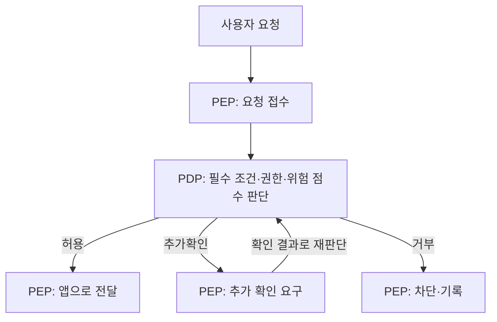

# A사 Zero Trust 적용 방안

## 5대 원칙 적용 방안

- ID: 직원 로그인에 MFA 적용을 확대하고, 비밀번호만으로 접속할 수 있는 경로를 점검한다. 퇴사 계정은 비활성화한다.
- Device: 접속 기기가 해당 계정의 등록 기기인지 확인하고, 백신·패치 등 기기 보안 상태도 검사한다. 등록 정보가 다르거나 보안 기준을 충족하지 못하면 접근을 제한한다.
- Network: 직원 PC와 서버 구역을 나누고, 업무에 필요한 연결과 포트만 허용한다. 승인되지 않은 직원 기기의 DB 직접 연결을 제한한다.
- Application: 부서와 역할에 따라 필요한 자원만 허용한다. 영업팀의 정산 자료 조회와 일반 직원의 계정 권한 변경처럼 업무 범위를 벗어나는 접근을 제한한다.
- Policy: 접속 시간·위치·기기 상태·MFA 여부·조회량을 함께 판단한다. 요청 한 건의 조회량뿐 아니라 일정 시간 동안의 반복 횟수와 누적 조회량도 확인하도록 보완한다.

## 판단과 집행

- PDP(결정): 정산 포털 등의 접근 요청을 판단하는 정책 서비스에 둔다. 재직 여부, 등록 기기, 자원 이용 권한 등 필수 조건을 확인하고 위험 점수에 따라 허용·추가확인·거부를 결정한다.
- PEP(집행): 보호할 앱 앞의 접근 통제 지점에 둔다. PDP의 결정에 따라 요청을 앱으로 전달하거나, 추가 확인을 요구하거나, 차단한다.
- 정산 조회의 위험 점수 기준은 50점 이상 거부, 20점 이상 50점 미만 추가확인, 20점 미만 허용으로 한다. 필수 조건을 충족하지 못하면 점수와 관계없이 거부한다.
- 자원별 권한 검사와 누적 조회량 분석은 3교시 예제 함수에서 추가로 보완해야 할 부분이다.

## 흐름도

- 허용·추가확인·거부에 따라 PEP가 수행할 동작을 세 가지로 나누었다.

## 최소권한 기준 (목록에 없으면 거부)

- 재무팀: 담당 자원인 SETTLE 정산 내역 조회를 허용한다.
- 영업팀: 담당 자원인 SALES 영업 실적 조회를 허용한다. SETTLE은 별도의 승인된 권한이 없으면 거부한다.
- 서비스 계정 batch-night: 등록된 SRV-BATCH에서 매일 02:00에 수행하는 정산 집계에 필요한 SETTLE 접근만 허용한다. 그 밖의 자원과 용도로 사용하는 것은 거부한다.
- 계정 권한 변경 기능은 별도의 관리자 역할과 접근 조건을 충족한 경우에만 허용한다.
- 허용 목록에 없는 자원과 기능은 기본 거부한다.

## 스코어링 결과

- 평가 범위: 제공된 직원 12명 정보와 A사 현황을 사용한 수업용 평가
- MFA: 10/20점
- 기기 보안 점검: 5/20점
- 최소권한: 15/20점
- 세그멘테이션: 0/20점
- 위험 기반 인증: 0/20점
- 총점: 30/100점
- 먼저 개선할 항목: Device
- 이유: 새벽 사건에서 해당 계정의 등록 기기와 다른 기기의 접근이 허용됐고, 제공된 직원 12명 중 기기 점검을 통과한 직원도 3명뿐이다. 등록 기기 확인과 보안 상태 점검을 우선 적용할 필요가 있다.